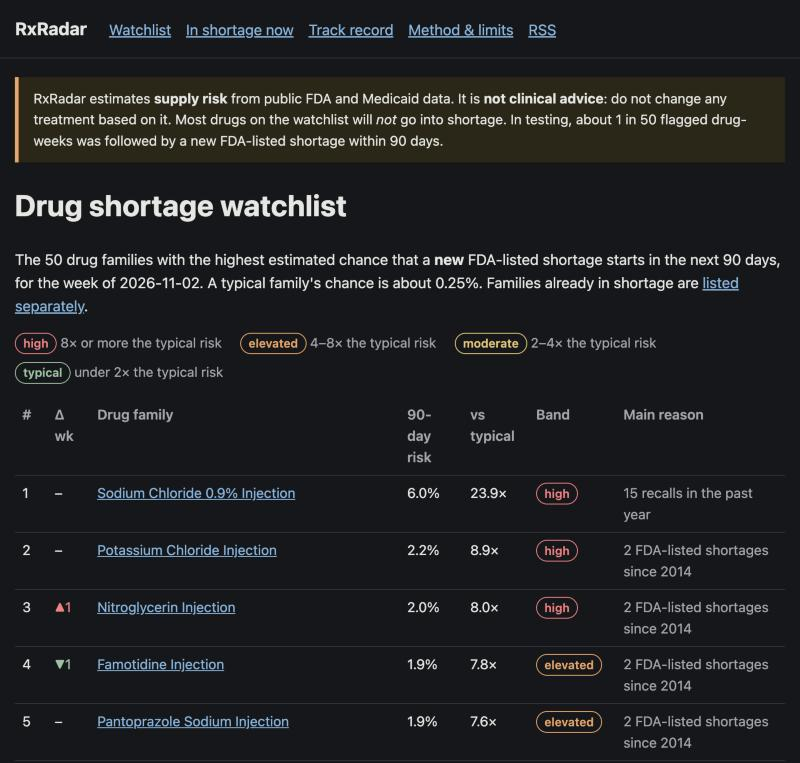
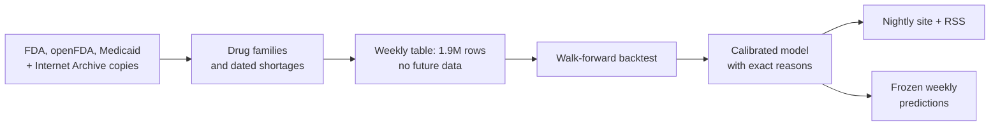

# RxRadar: forecasting US drug shortages from public data

**[Live site](https://anoopibrampur.github.io/rxradar/)** · [Model card](model_card.md) · [Data audit](data_audit.md) · [Decision log](decisions.md)

RxRadar estimates which drugs are most likely to enter a new FDA-listed shortage in the next 90 days. It publishes a ranked watchlist with plain-English reasons, and updates itself every night on free infrastructure.

**The short version**

- Rebuilt 12 years of shortage history that FDA doesn't publish, from Internet Archive copies of FDA's own web page.
- Tested the model year by year using only what was public at the time. A 100-drug watchlist would have flagged about **1 in 4** new shortages at least a month early, against about 1 in 45 for random.
- It's still imprecise: only about **1 in 50** flagged drug-weeks led to a shortage. The site says so on every page.
- Since November 2026, each week's predictions are frozen in public before the outcomes are known, under scoring rules published in advance.

## The problem

Drug shortages disrupt patient care. A 2024 UC Berkeley project on this problem reported about 93% AUC but about 0.1% precision after calibration. That gap is why I didn't treat AUC as the goal. New shortages are so rare (about 0.25% of drug families per 90 days) that a model can look excellent on AUC while being useless as a list a person would act on.

So I set the bar differently: rank drugs well enough that a short watchlist is worth reading, and report precision, recall, lead time and calibration honestly.

The hard constraints: free and non-commercial, public government data only, no clinical advice, and every feature must use only data that was public on its date.

## The hard part was the data

**The labels didn't exist.** The brief assumed openFDA had shortage history back to 2012. A few live queries on day one showed it didn't: of 1,604 records, only 19 were resolved. FDA drops old shortages, and the "current and historical" file linked on its site returns a 404.

I rebuilt the history from about 460 weekly Internet Archive captures of FDA's shortage page, 2014 to 2026. Then I validated it: 4 of the 5 new shortages FDA listed in 2026 appeared in the rebuilt data 3 to 6 days after their official posting date. The fifth was a new package added to an existing shortage.

**One renaming nearly broke everything.** In one week of September 2023, FDA renamed its listings, and 129 fake "new shortages" appeared. "Amifostine Injection" became "Amifostine Injection, Powder, Lyophilized, For Solution", for example. This is why every drug is keyed to a stable identity (active ingredient, form and route) built from FDA's substance database, not to a name. Matching on raw names gave 185 new shortages for 2023; keying on families brought that to 42.

**Names were messy in surprising ways.** "mg" matched magnesium and "ER" matched erbium in the substance database. Gemcitabine's "active moiety" pointed at its own metabolites. Potassium chloride and potassium acetate both reduced to "potassium ion". Each case became a tested rule. In the end, 90% of the shortage names ever listed as current map to a drug family, and the 64 that don't are listed in the repo instead of being guessed.

## Approach

- **Features:** shortage history, manufacturer counts and exits, recalls and Medicaid drug prices.
- **No look-ahead:** a reusable test recomputes each feature with data cut off at week *t* and fails if anything changes. It catches a planted leak, such as dating recalls by when they began instead of when they were published (a median 47 days earlier).
- **Backtest:** retrain each January, score that year, and never train on a label that wasn't yet known. Model settings were fixed in advance, because tuning on about 270 events would quietly overfit the test.

## Results

178 shortages could be scored at a 4-week lead, across 2017 and 2020 to 2026.

| Model | Flagged in top 100, 4+ weeks early | Precision, top 50 | PR-AUC |
|---|---|---|---|
| Random | 2% | 0.3% | 0.0025 |
| Hand-written rule | 11% | 1.3% | 0.0058 |
| **Logistic regression (12 features)** | **24%** (95% CI 18–30%) | **1.9%** | **0.0099** |
| LightGBM (35 features) | 21% (95% CI 15–26%) | 1.6% | 0.0093 |

Three findings I didn't expect:

1. **The simple model tied the complex one.** So I shipped logistic regression. Its score is a sum of per-feature terms, which means the "why" shown for each drug is exact, not approximated.
2. **What kind of drug it is carries most of the signal.** Four basic features alone reach 15%. All the supply-side data only lifts LightGBM to 21%, and the confidence intervals overlap. With this few shortages, I can't claim those signals help, so I don't.
3. **Raw probabilities were badly overconfident.** The top 0.1% of scores claimed 13.5% and came true 1.9% of the time. After calibration, tested year by year, they claim 3.0% against 3.7% observed. The real risks turned out to be only a few percent, so the site shows bands relative to a typical drug.

## What I got wrong

These are the parts I'd most like to discuss in an interview.

- **My first headline metric favoured random guessing.** I scored a drug as "caught" if it reached the top-k in any of the 13 weeks before a shortage. In the first backtest, random beat every model on it (17% vs 13%), which made no sense given the models' 5 to 6× precision. A random list reshuffles weekly and gets 13 tries, while a stable model gets one. I replaced it with a fixed-lead version, wrote a test that demonstrates the bias, and kept both numbers in the model card because the change came after seeing results.
- **I almost used a leaky feature.** Past manufacturer counts looked easy to rebuild from today's FDA files using marketing dates. Comparing against archived copies showed otherwise: the rebuild missed about a third of 2016 drug families and got single-source status right only 61% of the time. Supply features now read 25 archived directories, which is coarser but true to what was public.
- **A green pipeline wasn't a healthy one.** The first cloud run "succeeded" while FDA's site was silently blocking GitHub's servers as bots. I found it by reading the logs. I chose not to work around the block and switched to openFDA, FDA's official automated data service, after confirming the two lists matched.
- **A gitignore rule hid my data files.** Ignoring `data/` also matched a source folder, so CSVs the code depended on were never committed. Tests passed locally and failed in a clean clone. Now I check from a clean clone before every release.

## Proving it live

A backtest can always be accused of hindsight. So each week, RxRadar saves its full ranking to a [public branch](https://github.com/AnoopIbrampur/rxradar/tree/predictions) and never rewrites it. The scoring rules were committed before any result existed. The [Track Record page](https://anoopibrampur.github.io/rxradar/track-record.html) will list every shortage, caught or missed, against both random and the simple rule.

New shortages are rare, so this will take a long time to say anything firm, and the page says that too. The first full week reaches its 90 days around February 2027.

## Engineering

- **Stack:** Python, DuckDB, Parquet, scikit-learn, LightGBM, GitHub Actions, GitHub Pages. About 4,500 lines of code and 110 tests.
- **Cost:** $0. The full raw history is about 5 GB, so the nightly job runs from a 72 MB saved state in about 2.5 minutes.
- **Failure handling:** if a source is down, the run continues on the last good data and the site shows how fresh each source is.

## Limits

- It catches about 1 in 4 shortages and misses the rest.
- It only sees shortages FDA lists, and about 10% of FDA's names (mostly multi-ingredient products like IV nutrition) aren't matched.
- FDA inspection results, probably the most relevant signal, aren't in the model yet. They need an API key, and the client is written but untested against the live API.
- Medicaid prices cover retail pharmacies, so most hospital injectables have no price.

**Next:** inspection data, then risk that follows a single factory across all the drugs it makes.

*Built with Claude Code as a coding assistant. I set the goals and constraints, reviewed the evidence, and made the project decisions.*
